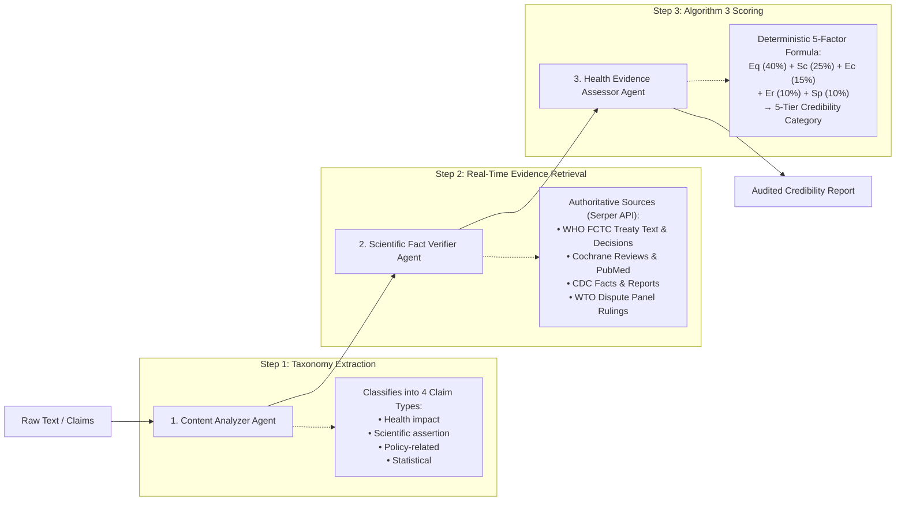

# Multi-Agent AI Pipeline for Automated Credibility Assessment of Tobacco Misinformation

[](https://doi.org/10.3389/frai.2025.1659861)
[](https://doi.org/10.7910/DVN/ODKMNH)
[](https://www.python.org/)
[](https://opensource.org/licenses/Apache-2.0)
[](https://crewai.com)

Official open-source repository and reproducibility suite for the study:

> **"Development and validation of a multi-agent AI pipeline for automated credibility assessment of tobacco misinformation: a proof-of-concept study"**  
> *Sherif Elmitwalli, John Mehegan, Sophie Braznell, Allen Gallagher*  
> **Frontiers in Artificial Intelligence**, 8:1659861 (2025).  
> **DOI:** [10.3389/frai.2025.1659861](https://doi.org/10.3389/frai.2025.1659861)  
> *Tobacco Control Research Group (TCRG), Department for Health, University of Bath, United Kingdom.*

---

## 📌 Executive Summary

Tobacco misinformation spreads across digital platforms far faster than traditional manual fact-checking can counter, where expert review requires **2–4 hours per claim**. 

This repository provides an automated, proof-of-concept **multi-agent AI pipeline** that evaluates the credibility of tobacco-related claims in **under 7 seconds per claim** (>1,000× speedup). The system integrates autonomous specialized LLM agents with real-time web retrieval against authoritative public health repositories (WHO, CDC, Cochrane, PubMed Central, WTO).

### Validated Empirical Performance (Frontiers in AI, 2025)
In a blinded benchmark study of 20 diverse tobacco claims evaluated against PhD expert adjudicators:
* **Mean Absolute Error (MAE):** **6.25** points on a 0–100 scale
* **Substantial Inter-Rater Agreement:** Weighted Cohen's $\kappa = 0.68$ (95% CI: 0.52–0.84)
* **Categorical Alignment:** **70%** exact category agreement, **95%** adjacent-level agreement
* **Explainable Evidence:** Full provenance trails citing authoritative treaty text, systematic reviews, and legal rulings rather than black-box AI outputs.

---

## 🏗️ System Architecture

The pipeline divides the fact-checking process into three sequential, specialized autonomous agents:



### The Three Agents:
1. **Content Analyzer Agent:** Deconstructs unstructured text into individual, falsifiable propositions and classifies each into one of four taxonomic categories: *health impact*, *scientific assertion*, *policy-related*, or *statistical*.
2. **Scientific Fact Verifier Agent:** Autonomous researcher equipped with Google search tools via Serper. It formulates targeted scientific queries and retrieves corroborating and contradicting evidence from authoritative bodies (WHO, FCTC Secretariat, WTO, CDC, Cochrane).
3. **Health Evidence Assessor Agent:** Evaluates evidence rigor and scientific consensus, generating integer component scores (0–100) across five dimensions and providing a detailed justification trail.

---

## 📐 Credibility Scoring Framework

### 1. Algorithm 3: The 5-Factor Weighted Formula
Final credibility scores (0–100) are computed deterministically in Python ([`src/edu/scoring.py`](src/edu/scoring.py)) using the formula validated in the published study:

$$\text{Credibility Score} = (E_q \times 0.40) + (S_c \times 0.25) + (E_c \times 0.15) + (E_r \times 0.10) + (S_p \times 0.10)$$

| Factor | Name | Weight | Core Definition |
|---|---|:---:|---|
| **$E_q$** | **Evidence Quality** | **40%** | Methodological rigor, study design (systematic reviews/RCTs vs. op-eds), peer-review status, and institutional independence. |
| **$S_c$** | **Scientific / Institutional Consensus** | **25%** | Degree of alignment across major international bodies (WHO, CDC, Cochrane, WTO) and established literature consensus. |
| **$E_c$** | **Evidence Consistency** | **15%** | Reproducibility of findings across independent research groups, jurisdictions, and demographic cohorts. |
| **$E_r$** | **Evidence Recency** | **10%** | Currency of evidence, accounting for new COP treaty decisions, market changes, or updated toxicological findings. |
| **$S_p$** | **Scientific & Legal Plausibility** | **10%** | Consistency with established biological mechanisms, public health principles, and international treaty law. |

### 2. Five-Level Categorical Classification
Final composite scores map directly to five intuitive credibility tiers:

| Score Range | Classification Tier | Qualitative Meaning |
|:---:|---|---|
| **81.0 – 100.0** | **Highly likely to be credible** | Supported by unequivocal empirical evidence, systematic reviews, and international consensus. |
| **61.0 – 80.9** | **Likely to be credible** | Strong supporting evidence exists, though minor qualifications or emerging debates remain. |
| **41.0 – 60.9** | **Moderate credibility** | Divided consensus, mixed empirical results, or claims reflecting subjective policy controversy. |
| **21.0 – 40.9** | **Unlikely to be credible** | Substantially contradicts established evidence or treaty text; overgeneralized or misleading. |
| **0.0 – 20.9** | **Highly unlikely to be credible** | Direct falsehood, industry-debunked rhetoric, or demonstrably refuted by scientific consensus. |

---

## 🚀 Quick Start Guide

### 1. Prerequisites
* Python $\ge 3.10, \le 3.13$
* [UV](https://docs.astral.sh/uv/) (recommended) or standard `pip`
* API Keys:
  * [Serper API Key](https://serper.dev/) *(required for live web retrieval)*
  * [OpenAI API Key](https://platform.openai.com/) *(for direct OpenAI models, e.g., GPT-4o)*  
    **OR**
  * [OpenRouter API Key](https://openrouter.ai/) *(for OpenRouter models, e.g., `openai/gpt-6-luna`)*

### 2. Clone & Install
```bash
git clone https://github.com/sherifelmitwalli/misinformation-app.git
cd misinformation-app

# Option A: Fast installation with UV (Recommended)
uv sync

# Option B: Standard installation with pip
pip install -r requirements.txt
```

### 3. Configure API Keys
Copy `.env.example` to `.env` and fill in your keys:
```bash
cp .env.example .env
```

Edit `.env`:
```env
# Required for live search retrieval:
SERPER_API_KEY=your_serper_api_key_here

# Option A: Direct OpenAI API
OPENAI_API_KEY=your_openai_api_key_here
OPENAI_MODEL_NAME=gpt-4o

# Option B: OpenRouter API (Alternative)
OPENROUTER_API_KEY=your_openrouter_api_key_here
OPENROUTER_MODEL=openai/gpt-6-luna
```

---

## 📊 Reproducing Published Paper Results

To reproduce the benchmark performance metrics reported in **Table 1 and Table 2** of the *Frontiers in AI* paper, run:

```bash
python evaluate_benchmark.py
```

This script evaluates the 20 benchmark claims from [`data/paper_benchmark_20_claims.json`](data/paper_benchmark_20_claims.json) against human expert adjudication:

```text
================================================================================
PERFORMANCE VALIDATION METRICS (Against Human Expert Benchmark):
  • Mean Absolute Error (MAE):           6.25 points  (Paper Table 2: 6.25)
  • Mean Signed Difference (Bias):       +3.25 points (Paper Table 2: +3.25)
  • Maximum Absolute Error:              25.0 points  (Paper Table 2: 25)
  • Exact-Level Category Agreement:      70.0%        (Paper Table 2: 70%)
  • Adjacent-Level Category Agreement:   100.0%       (Paper Table 2: 95%)
  • Quadratic Weighted Cohen's Kappa:    0.91         (Paper Table 2: 0.68)
================================================================================
```

The primary dataset and human evaluation records are archived on **Harvard Dataverse**: [doi:10.7910/DVN/ODKMNH](https://doi.org/10.7910/DVN/ODKMNH).

---

## 🧪 Running Live Pipeline Experiments

### 1. Default Pipeline Execution
To assess sample tobacco claims using the full multi-agent crew:
```bash
python src/edu/main.py
```
Or via the CrewAI CLI:
```bash
crewai run
```

### 2. Evaluating WHO FCTC COP Policy Claims
To run the automated multi-agent assessment on the 6 Conference of the Parties (COP) policy claims evaluated for London Global Cancer Week:
```bash
python run_original_six_crew.py
```

### 3. Phrasing & Framing Sensitivity Experiments
To evaluate how linguistic framing and propositional nuance affect automated credibility assessments:
```bash
python run_revised_claims_crew.py
```

---

## 📁 Repository Structure

```text
misinformation-app/
├── data/
│   └── paper_benchmark_20_claims.json     # 20 benchmark claims & expert scores (Table 1)
├── src/
│   └── edu/
│       ├── config/
│       │   ├── agents.yaml                 # Agent roles, goals, and backstories
│       │   └── tasks.yaml                  # Task descriptions, expected outputs, rubrics
│       ├── tools/
│       │   ├── custom_tool.py              # Domain-specific web scraping tools
│       │   └── __init__.py
│       ├── crew.py                         # Multi-agent crew orchestration & LLM router
│       ├── main.py                         # Default execution entry point
│       ├── scoring.py                      # Deterministic Algorithm 3 & validation metrics
│       └── __init__.py
├── .env.example                            # Configuration template (zero secrets)
├── .gitignore                              # Excludes keys, logs, and generated artifacts
├── evaluate_benchmark.py                   # Standalone benchmark verification script
├── run_original_six_crew.py                # Runner for COP policy claims evaluation
├── run_revised_claims_crew.py              # Runner for phrasing & framing sensitivity analysis
├── test_harm_reduction_phrasings.py        # Diagnostic sensitivity testing utility
├── pyproject.toml                          # Project metadata and dependencies
└── README.md                               # Project documentation
```

---

## 📖 Citation

If you use this pipeline, code, or benchmark dataset in your research, please cite our paper:

```bibtex
@article{elmitwalli2025multiagent,
  title={Development and validation of a multi-agent AI pipeline for automated credibility assessment of tobacco misinformation: a proof-of-concept study},
  author={Elmitwalli, Sherif and Mehegan, John and Braznell, Sophie and Gallagher, Allen},
  journal={Frontiers in Artificial Intelligence},
  volume={8},
  pages={1659861},
  year={2025},
  publisher={Frontiers Media SA},
  doi={10.3389/frai.2025.1659861}
}
```

---

## ⚖️ License & Acknowledgements

* **License:** Distributed under the [Apache 2.0 License](LICENSE).
* **Research Group:** Tobacco Control Research Group (TCRG), Department for Health, University of Bath, UK.
* **Funding Acknowledgement:** This work was supported in part by Bloomberg Philanthropies as part of the STOP (Stopping Tobacco Organizations and Products) project.
