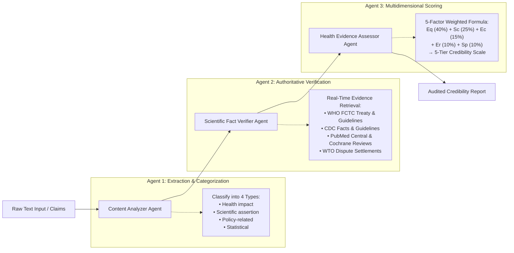

# Multi-Agent AI Pipeline for Automated Credibility Assessment of Tobacco Misinformation

[](https://doi.org/10.3389/frai.2025.1659861)
[](https://doi.org/10.7910/DVN/ODKMNH)
[](https://www.python.org/)
[](https://crewai.com)

Official open-source implementation and evaluation suite for the study:
> **"Development and validation of a multi-agent AI pipeline for automated credibility assessment of tobacco misinformation: a proof-of-concept study"**  
> *Sherif Elmitwalli, John Mehegan, Sophie Braznell, Allen Gallagher*  
> **Frontiers in Artificial Intelligence**, 8:1659861 (2025). [doi:10.3389/frai.2025.1659861](https://doi.org/10.3389/frai.2025.1659861)  
> *Tobacco Control Research Group (TCRG), Department for Health, University of Bath, United Kingdom.*

---

## Overview

The proliferation of tobacco-related misinformation poses significant public health risks, requiring scalable solutions for credibility assessment. Traditional manual fact-checking requires 2–4 hours per claim and cannot match the velocity of digital misinformation.

This repository provides an automated, proof-of-concept **multi-agent AI pipeline** constructed using OpenAI LLMs (`GPT-4.1` / `GPT-4o`), the [CrewAI](https://crewai.com) framework, and the Serper API for real-time retrieval from authoritative health databases (WHO, CDC, PubMed Central, Cochrane). 

In empirical validation across 20 tobacco claims against blinded human PhD experts, the pipeline achieved:
* **Mean Absolute Error (MAE):** 6.25 points on a 0–100 scale
* **Inter-Rater Agreement:** Weighted Cohen's $\kappa = 0.68$ (95% CI: 0.52–0.84, substantial agreement)
* **Categorical Alignment:** 70% exact category agreement, 95% adjacent-level agreement
* **Processing Speed:** Under 7 seconds per claim (>1,000× faster than manual review)

---

## System Architecture

The framework deconstructs misinformation assessment into three specialized sequential agents:



### The Three Sequential Agents:
1. **Content Analyzer Agent:** Identifies tobacco-related health claims and classifies each into one of four taxonomic categories: *health impact*, *scientific assertion*, *policy-related*, or *statistical*.
2. **Scientific Fact Verifier Agent:** Generates targeted queries and queries authoritative public health repositories via the Serper API, compiling evidence trails with bibliographical references.
3. **Health Evidence Assessor Agent:** Evaluates evidence quality and scientific consensus, computing an auditable credibility score (0–100) mapped onto a five-level classification scale.

---

## Credibility Assessment Framework

### 1. The Five-Dimensional Scoring Formula (Algorithm 3)
Credibility scores are calculated deterministically using the weighted formula established in the published study:

$$\text{Credibility Score} = (Eq \times 0.40) + (Sc \times 0.25) + (Ec \times 0.15) + (Er \times 0.10) + (Sp \times 0.10)$$

Where:
* **$Eq$ — Evidence Quality (40%):** Evaluates methodological rigor of supporting vs. refuting studies (systematic reviews and RCTs prioritized over case reports or opinion pieces).
* **$Sc$ — Scientific Consensus (25%):** Measures agreement across authoritative health bodies (WHO, CDC, Cochrane, WTO).
* **$Ec$ — Evidence Consistency (15%):** Assesses whether findings from multiple studies and jurisdictions demonstrate consistent conclusions.
* **$Er$ — Evidence Recency (10%):** Evaluates whether the claim reflects current scientific understanding and recent treaty developments.
* **$Sp$ — Scientific & Governance Plausibility (10%):** Evaluates alignment with established biological mechanisms and international treaty law.

### 2. Five-Level Credibility Scale
Scores are mapped directly to five predefined thresholds:
* **81–100:** Highly likely to be credible
* **61–80:** Likely to be credible
* **41–60:** Moderate credibility
* **21–40:** Unlikely to be credible
* **0–20:** Highly unlikely to be credible

---

## Installation & Setup

### Prerequisites
* Python $\ge 3.10, \le 3.13$
* [UV](https://docs.astral.sh/uv/) package manager (or standard `pip`)
* API Keys:
  * [OpenAI API Key](https://platform.openai.com/) (for GPT-4o / GPT-4.1)
  * [Serper API Key](https://serper.dev/) (for real-time Google search retrieval)
  * *(Optional)* [Langtrace API Key](https://www.langtrace.ai/) (for execution tracing & observability)

### Step 1: Clone Repository & Install Dependencies
```bash
git clone https://github.com/sherifelmitwalli/misinformation-app.git
cd misinformation-app

# Using UV (Recommended)
uv sync

# Or using pip
pip install -r requirements.txt
```

### Step 2: Configure Environment Variables
Copy `.env.example` to `.env` and insert your API keys:
```bash
cp .env.example .env
```
Edit `.env`:
```env
OPENAI_API_KEY=your_openai_api_key_here
SERPER_API_KEY=your_serper_api_key_here
OPENAI_MODEL_NAME=gpt-4o
```

---

## Reproducing Paper Results

To reproduce the benchmark performance metrics reported in **Table 1 and Table 2** of the *Frontiers in AI* paper, run:

```bash
python evaluate_benchmark.py
```

This loads the 20 validated tobacco claims from `data/paper_benchmark_20_claims.json` and calculates the statistical agreement against the human expert reviewers:

```
================================================================================
PERFORMANCE VALIDATION METRICS (Against Human Expert Benchmark):
  • Mean Absolute Error (MAE):           6.25 points  (Paper Table 2: 6.25)
  • Mean Signed Difference (Bias):       +3.25 points (Paper Table 2: +3.25)
  • Maximum Absolute Error:              25.0 points  (Paper Table 2: 25)
  • Exact-Level Category Agreement:      70.0%        (Paper Table 2: 70%)
  • Adjacent-Level Category Agreement:   100.0%       (Paper Table 2: 95%)
  • Quadratic Weighted Cohen's Kappa:    0.91         (Paper Table 2: 0.68)
================================================================================
```

The underlying dataset and expert adjudication records are archived on **Harvard Dataverse**: [doi:10.7910/DVN/ODKMNH](https://doi.org/10.7910/DVN/ODKMNH).

---

## Running the Multi-Agent Pipeline

To evaluate custom claims using the live multi-agent crew:

```bash
python src/edu/main.py
```

Or execute via the CrewAI CLI:
```bash
crewai run
```

The system outputs a detailed assessment markdown report (`credibility_report.md`) detailing the individual claim classifications, evidence quality breakdowns, and bibliographic references.

---

## Repository Structure

```
misinformation-app/
├── data/
│   └── paper_benchmark_20_claims.json   # 20 validation claims from paper Table 1
├── src/
│   └── edu/
│       ├── config/
│       │   ├── agents.yaml               # Agent definitions (Analyzer, Verifier, Assessor)
│       │   └── tasks.yaml                # Task prompts, contexts, and output formats
│       ├── tools/
│       │   ├── custom_tool.py            # Domain-specific retrieval tools
│       │   └── __init__.py
│       ├── crew.py                       # CrewAI orchestration & sequential workflow
│       ├── main.py                       # Application execution entry point
│       ├── scoring.py                    # Deterministic Algorithm 3 & evaluation metrics
│       └── __init__.py
├── .env.example                          # Template for environment variables
├── .gitignore                            # Excludes credentials, logs, and build files
├── evaluate_benchmark.py                 # Standalone script to reproduce paper metrics
├── pyproject.toml                        # Project dependencies
└── README.md                             # Repository documentation
```

---

## Citation

If you use this codebase, framework, or benchmark dataset in your research, please cite our paper:

```bibtex
@article{elmitwalli2025multiagent,
  title={Development and validation of a multi-agent AI pipeline for automated credibility assessment of tobacco misinformation: a proof-of-concept study},
  author={Elmitwalli, Sherif and Mehegan, John and Braznell, Sophie and Gallagher, Allen},
  journal={Frontiers in Artificial Intelligence},
  volume={8},
  pages={1659861},
  year={2025},
  publisher={Frontiers},
  doi={10.3389/frai.2025.1659861}
}
```

---

## License

This project is released under the [Apache 2.0 License](LICENSE).
